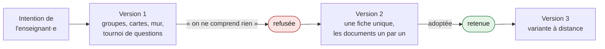
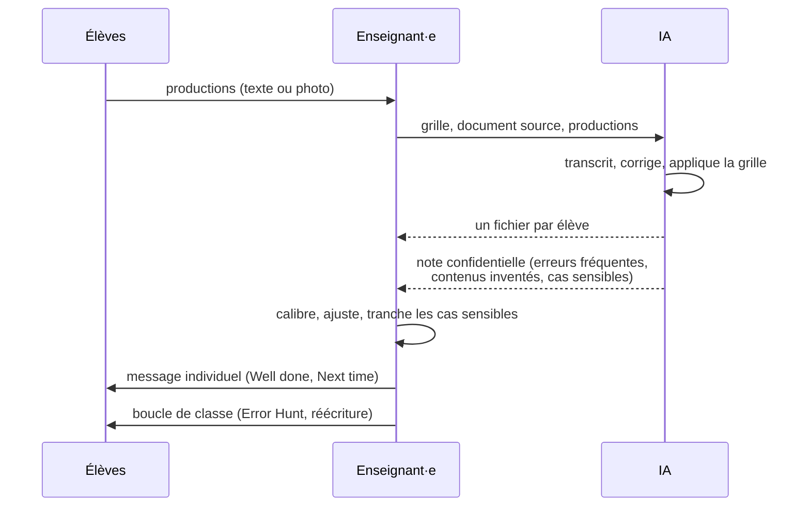

# 00. Le retour d'expérience

[← Retour au sommaire](README.md) · [Phase suivante : Analyse →](01-analyse.md)

## Contexte

Une séquence d'anglais en Terminale, niveau visé B2, sur l'axe du programme « Fictions et réalités ». La séquence s'étend sur plusieurs semaines et alterne séances en classe et travail à distance. La classe compte une vingtaine d'élèves.

L'enseignant·e a travaillé avec une IA générative tout au long de la séquence : une trentaine de demandes, de la conception des séances à la correction des copies. Le corpus de cette relecture est ce fil de travail : les demandes, les livrables produits (fiches élèves, déroulés, diaporamas, corrigés, grilles, fichiers de correction individuels) et les refus ou reformulations qui l'ont jalonné.

## Ce que demandait l'enseignant·e

Six intentions reviennent dans les demandes, même formulées dans l'urgence.

**Une cohérence autour d'une problématique.** Une sous-question par semaine, à laquelle répondent les documents, et dont la réponse alimente la question centrale. Un mur de réponses à deux colonnes, complété chaque semaine, rend ce raisonnement cumulatif visible.

**La production comme moteur.** « Il faut qu'ils aient l'impression de produire quelque chose. » Chaque séance vise un objet à rendre ou à présenter : un message, un pitch, un produit inventé, une carte de groupe.

**La simplicité comme contrainte.** « Parfois ce que tu fais est trop complexe. » Consignes courtes, une tâche par bloc, pas de diaporama superflu.

**La transparence des attendus.** Compétences et tâches évaluées annoncées en début de séance, grille critériée donnée avec la consigne, checklist avant de rendre.

**L'évaluation sans risque.** Toutes les productions sont notées en bonus : elles ne peuvent que faire monter la moyenne.

**Le réalisme de classe.** Qui a fait le travail à distance, quels outils numériques sont réellement disponibles, ce qu'on peut demander à un élève seul chez lui, le risque d'usage de l'IA sur un devoir non surveillé. C'est ce savoir situé, que l'IA n'a pas, qui tranche à chaque itération.

## Ce que produisait l'IA

L'IA a joué le rôle d'un bureau d'études : elle traduisait une intention en objets utilisables (fiche, déroulé minuté avec les consignes à dire, diaporama, corrigé, grille), avec une mise en page constante.

**Une tension productive.** Sur une séance de reprise, trois versions ont été produites en une heure : un dispositif en groupes avec cartes, mur et tournoi de questions, jugé incompréhensible ; une fiche unique reprenant les documents un par un, adoptée ; puis sa variante à distance. L'IA tend spontanément vers l'enrichissement (plus de structures, plus de rôles, plus de supports). L'enseignant·e tend vers la réduction. C'est la version la plus simple qui a été retenue.

*Une séance de reprise, trois versions en une heure : l'IA propose en enrichissant, l'enseignant·e tranche en simplifiant.*

**La vérification des contenus.** Le corrigé initial d'un court-métrage d'animation étudié en classe comportait des approximations. À la demande de l'enseignant·e, l'IA a examiné le film lui-même, ce qui a corrigé le corrigé, puis permis de repérer dans plusieurs copies des scènes qui n'existent pas dans le film.

**La constance.** La même grille a été appliquée à toutes les copies avec les mêmes seuils.

## La remédiation personnalisée

Chaque élève a reçu un fichier individuel :

- son texte intégral, erreurs barrées et corrections en rouge ;
- la grille critère par critère, avec une note et une phrase de commentaire ;
- le total ;
- une ligne **Well done** (une réussite nommée) et une ligne **Next time** (une ou deux priorités).

L'enseignant·e a demandé un format sans tableau, pour pouvoir le copier dans un message : le feedback devient un message adressé à l'élève, pas un document administratif.

Séparément, et pour l'enseignant·e seulement, l'IA signalait les erreurs les plus fréquentes, les contenus inventés, les copies qui semblaient aidées et les textes abordant un thème personnel sensible. Rien de cela n'apparaissait dans les fichiers des élèves.

L'enseignant·e a gardé le calibrage (des notes ont été contestées, affinées ou confirmées), la décision sur les cas sensibles, l'envoi des messages et la boucle de classe : lecture d'extraits réussis, travail collectif sur les erreurs fréquentes, réécriture.

## Ce qui reste fragile

Le cas laisse cinq questions ouvertes, reprises dans les phases suivantes :

1. Les notes, comprises entre 12,5 et 19,5 sur 20, sont élevées. Le statut bonus et des critères qui récompensent la présence d'un élément plus que sa qualité l'expliquent. → [Design](02-design.md)
2. La correction exhaustive donne toutes les réponses à l'élève, ce qui vide en partie la réécriture de son intérêt. → [Design](02-design.md)
3. La validation par l'enseignant·e repose sur la relecture de quelques fichiers seulement. → [Implémentation](04-implementation.md)
4. Des copies d'élèves, dont certaines manuscrites et certaines très personnelles, ont transité par un outil en ligne. → [Analyse](01-analyse.md)
5. Rien ne permet encore de dire si le feedback a été lu et utilisé. → [Évaluation](05-evaluation.md)
