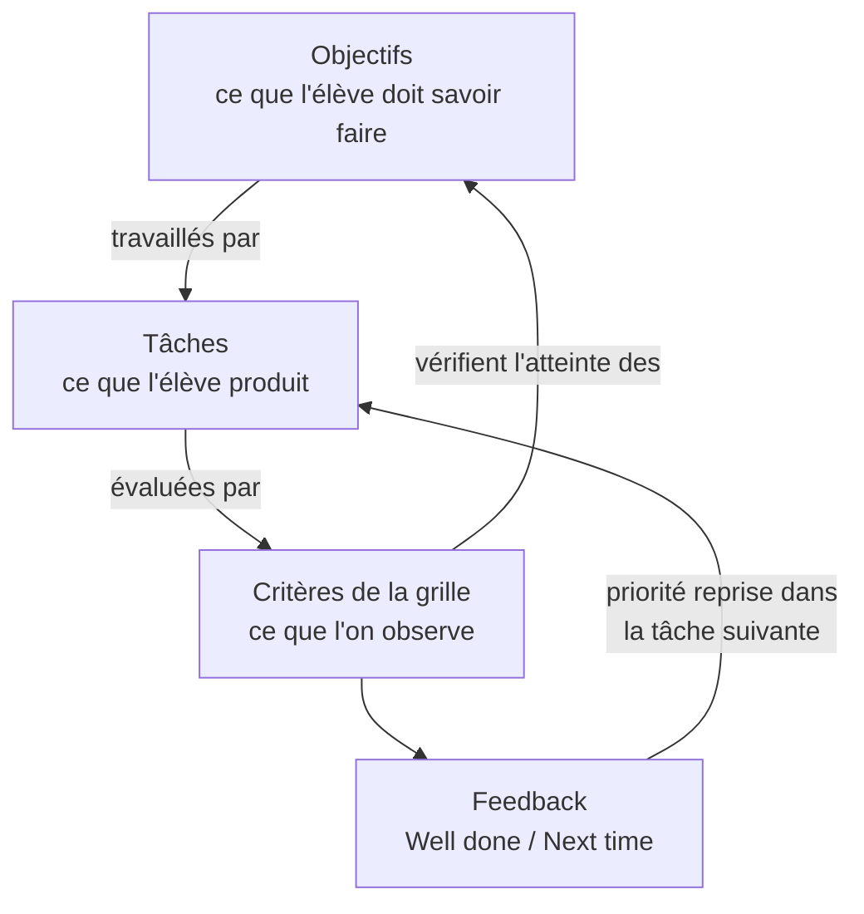
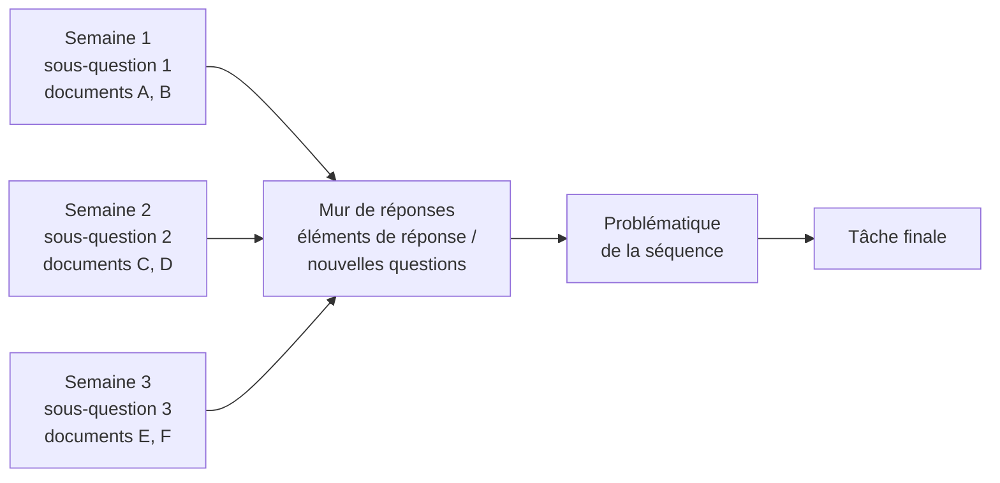
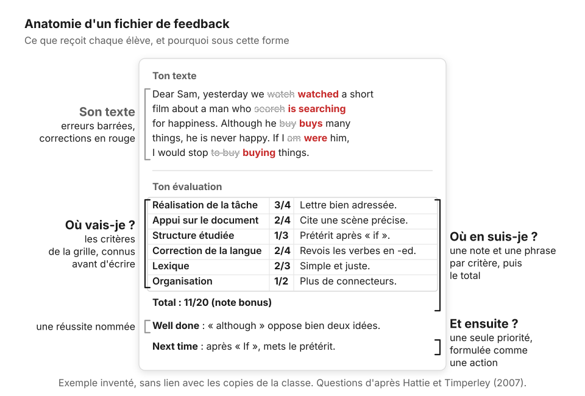
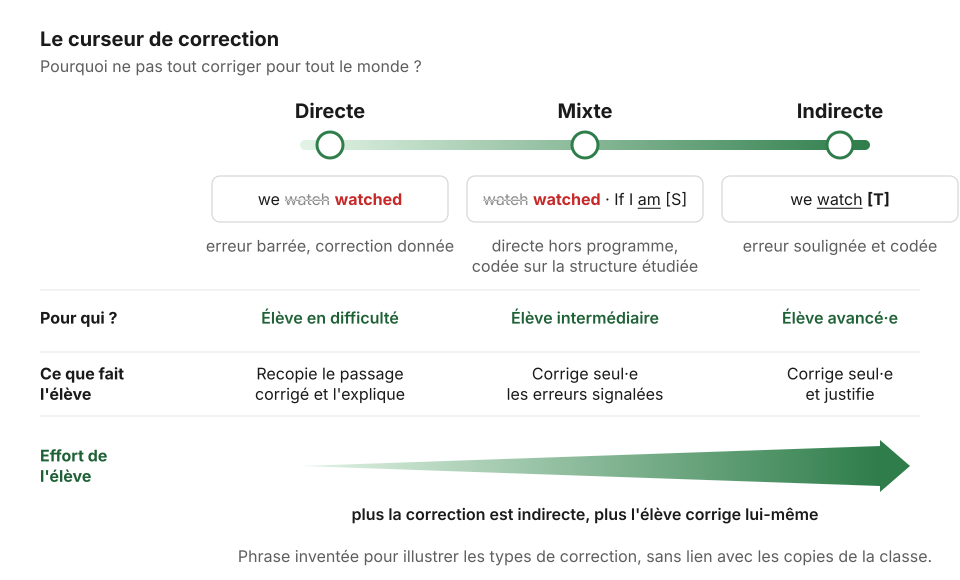

# 02. Design

[← Analyse](01-analyse.md) · [Sommaire](README.md) · [Phase suivante : Développement →](03-developpement.md)

**Question de la phase : quels objectifs, quelles tâches, quels critères, et quel feedback ?**

## Dans le cas

Le design est la force du cas :

- une **problématique** de séquence, déclinée en une sous-question par semaine, à laquelle répondent les documents de la semaine ;
- une **tâche de production** à chaque séance ;
- une **grille critériée** donnée avec la consigne ;
- des notes au statut **bonus** ;
- un format de **feedback** défini à l'avance (texte corrigé, note par critère, Well done, Next time).

Deux faiblesses : une grille dont plusieurs critères récompensaient la présence d'un élément plus que sa qualité, et un feedback qui corrigeait tout, ce qui laissait peu de travail à l'élève.

## Recommandations

### 1. Aligner objectifs, tâches et critères

L'alignement constructif (Biggs) demande que chaque critère de la grille évalue un objectif visé, et que chaque objectif soit travaillé par une tâche.

| Objectif | Tâche qui le travaille | Critère qui l'évalue |
|---|---|---|
| Rendre compte d'un document étudié | Production finale appuyée sur le document | Appui sur le document |
| Mobiliser une structure étudiée | Exercices puis réemploi dans la production | Mobilisation de la structure |
| ... | ... | ... |

Si un critère n'a pas d'objectif en face, il faut le supprimer. Si un objectif n'a pas de critère, il ne sera pas évalué.

### 2. Construire la problématique

Une question centrale, puis une sous-question par semaine. Chaque sous-question doit pouvoir être traitée avec les documents de la semaine et apporter une réponse partielle à la question centrale. Un support visible (mur, tableau partagé) garde la trace des réponses accumulées.

### 3. Écrire une grille avec descripteurs de niveau

C'est la principale correction apportée au cas. Une grille qui dit seulement « utilise le document » produit des notes généreuses et peu informatives. Pour chaque critère, décrire ce qu'est un niveau insuffisant, partiel, atteint et dépassé.

- Cinq à six critères.
- Au moins un critère lié à un **contenu vu en classe** (une scène précise, un argument du texte étudié) : c'est aussi la meilleure protection contre les productions entièrement générées.
- Au moins un critère lié à une **structure enseignée**.
- Des descripteurs observables, compréhensibles par les élèves.

Voir le modèle : [gabarits/grille-criteriee.md](gabarits/grille-criteriee.md).

### 4. Décider du statut de la note

Le statut bonus réduit l'anxiété et encourage à produire. Il brouille aussi le signal de la note : tout le monde a « bien ». Deux options cohérentes :

- garder le bonus, mais calibrer la grille pour que la note reste informative ;
- ou dissocier : feedback sans note sur les productions intermédiaires, note sur la production finale seulement.

### 5. Concevoir le feedback

Le format du cas applique le modèle de Hattie et Timperley : où vais-je (les critères), où en suis-je (la note commentée), quelle est la prochaine étape (Next time). Deux ajustements :

**Moduler la correction selon les élèves.** La correction directe (l'erreur et sa correction) aide surtout les élèves les plus fragiles. Pour les autres, la correction indirecte (erreur soulignée ou codée, sans la réponse) les oblige à chercher, et c'est cette recherche qui fait progresser.

| Profil | Type de correction | Ce que fait l'élève ensuite |
|---|---|---|
| Élève en difficulté sur la langue | Directe : erreur barrée, correction donnée | Recopie le passage corrigé et l'explique |
| Élève intermédiaire | Mixte : directe sur les erreurs hors programme, indirecte sur les structures étudiées | Corrige seul·e les erreurs signalées |
| Élève avancé·e | Indirecte : erreur soulignée et codée | Corrige seul·e et justifie |

**Une seule priorité.** La ligne Next time ne porte qu'une priorité, formulée comme une action (« Utilise *although* pour opposer deux idées dans ton prochain texte »), pas comme un manque.

### 6. Prévoir la boucle dès maintenant

Le feedback n'a d'effet que s'il est utilisé (Carless et Boud). Prévoir dès le design :

- un temps de classe pour lire son feedback et réécrire ;
- un exercice collectif construit sur les erreurs réelles de la classe (Error Hunt) ;
- la reprise de chaque priorité Next time dans la grille de la production suivante.

## Outils

- [gabarits/grille-criteriee.md](gabarits/grille-criteriee.md)
- [gabarits/modele-feedback.md](gabarits/modele-feedback.md)
- Le gabarit « Concevoir une séquence cohérente » dans [gabarits/prompts.md](gabarits/prompts.md)

## Points de vigilance

- Ne pas laisser l'IA proposer la grille seule : elle produit des grilles plausibles mais génériques. La grille est un acte de l'enseignant·e, l'IA peut aider à rédiger les descripteurs.
- La transparence des attendus vaut aussi pour l'IA : si les élèves savent que le feedback est préparé avec une IA, ils doivent savoir que les critères sont ceux de l'enseignant·e.

## Checklist de sortie

- [ ] Chaque critère correspond à un objectif, chaque objectif à une tâche.
- [ ] La grille a des descripteurs pour chaque niveau.
- [ ] Un critère porte sur un contenu vu en classe, un sur une structure enseignée.
- [ ] Le statut de la note est décidé.
- [ ] Le type de correction est décidé pour chaque profil d'élève.
- [ ] Le temps de classe consacré au feedback est prévu dans la progression.
