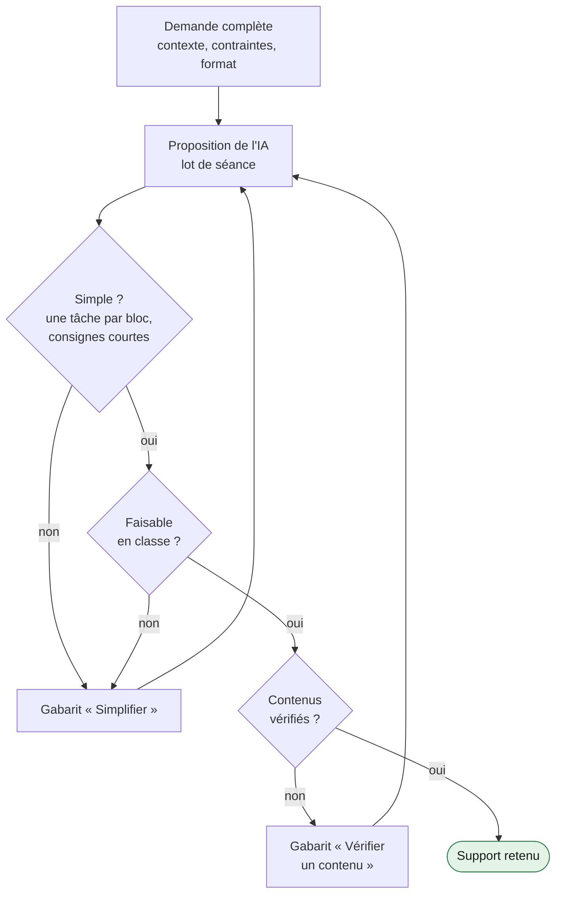

# 03. Développement

[← Design](02-design.md) · [Sommaire](README.md) · [Phase suivante : Implémentation →](04-implementation.md)

**Question de la phase : comment produire avec l'IA des supports simples, justes et utilisables en classe ?**

## Dans le cas

L'IA a produit des lots complets par séance : fiche élève, déroulé minuté avec les phrases à dire, diaporama court, corrigé. L'enseignant·e a filtré systématiquement. Sur une séance, trois versions ont été produites et deux écartées.

Deux enseignements :

1. **L'IA enrichit, l'enseignant·e réduit.** L'IA ajoute spontanément des rôles, des étapes, des supports. La version retenue est presque toujours la plus simple.
2. **L'IA invente si on la laisse faire.** Le premier corrigé d'un film comportait des approximations ; il a fallu exiger que l'IA examine le film lui-même.

## Recommandations

### 1. Donner à l'IA tout le contexte d'un coup

Programme, documents, durée de la séance, présentiel ou distance, ce que les élèves ont déjà fait, règles de forme (police, interligne, langue des consignes). Une demande complète produit une première version plus proche du besoin et réduit les itérations.

### 2. Demander un lot, pas un support isolé

Fiche élève, déroulé, diaporama, corrigé : produits ensemble, ils restent cohérents entre eux (mêmes consignes, même ordre, même vocabulaire).

### 3. Filtrer avec des critères de refus explicites

Le cas montre que l'expertise de l'enseignant·e se joue surtout ici. On la rend transmissible en écrivant ses critères de refus. Une proposition est refusée si :

- [ ] une consigne dépasse deux lignes ou contient deux actions ;
- [ ] un bloc demande plus d'une tâche ;
- [ ] le dispositif suppose des rôles, des groupes ou du matériel qu'on n'a pas le temps d'installer ;
- [ ] la durée prévue ne tient pas dans la séance réelle (en comptant l'installation et les retards) ;
- [ ] un élève absent la séance précédente ne peut pas suivre ;
- [ ] il faut lire la consigne deux fois pour la comprendre ;
- [ ] la version à distance suppose une interaction impossible seul·e chez soi ;
- [ ] le corrigé cite un document que l'IA n'a pas effectivement lu ou vu.

Refuser n'est pas un échec : c'est le mode normal de travail. Le gabarit « Simplifier » permet de relancer sans repartir de zéro.

### 4. Faire de la vérification des contenus une règle

Tout document cité dans un corrigé ou une grille (texte, film, vidéo, image) doit avoir été lu ou vu par l'IA. Lui demander les repères vérifiés (minutage, citations) et ce qu'elle n'a pas pu vérifier. Si l'outil ne peut pas lire le document, l'enseignant·e rédige le corrigé.

### 5. Préparer les outils de remédiation avant la collecte

Avant que les élèves produisent, préparer :

- la consigne de remédiation (gabarit « Remédiation personnalisée ») adaptée à la grille ;
- le modèle de fichier individuel ;
- le tableau de suivi des priorités.

On gagne du temps au moment où il en manque le plus, et on s'assure que le feedback évaluera bien ce que la grille annonce.

## Outils

Dans [gabarits/prompts.md](gabarits/prompts.md) :

- « Produire un lot de séance »
- « Simplifier »
- « Vérifier un contenu »
- « Adapter au travail à distance »

## Points de vigilance

- La mise en page soignée de l'IA peut masquer un contenu faible. Juger le support comme le ferait un élève qui le découvre.
- Garder une trace des versions refusées et de la raison du refus : c'est la matière la plus utile pour former d'autres collègues.

## Checklist de sortie

- [ ] Chaque séance a son lot : fiche, déroulé, diaporama si utile, corrigé.
- [ ] Chaque support a passé les critères de refus.
- [ ] Chaque corrigé repose sur un document effectivement lu ou vu.
- [ ] La consigne de remédiation et le modèle de feedback sont prêts.
