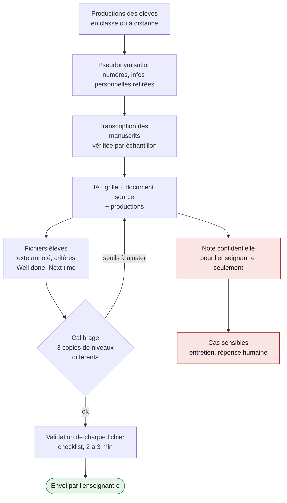

# 04. Implémentation

[← Développement](03-developpement.md) · [Sommaire](README.md) · [Phase suivante : Évaluation →](05-evaluation.md)

**Question de la phase : comment faire produire, collecter, corriger avec l'IA et envoyer un feedback qu'on a validé ?**

Cette phase contient l'évaluation **des apprentissages** : la correction des copies et le feedback. L'évaluation **du dispositif** relève de la phase suivante.

## Dans le cas

- Production en classe quand c'était possible ; à distance, seule la production finale était demandée, par photo ou texte, avec une échéance courte.
- Les productions ont été rassemblées en un seul lot ; les manuscrits ont été transcrits par l'IA.
- L'IA a produit un fichier par élève et, séparément, une note pour l'enseignant·e (erreurs fréquentes, contenus inventés, copies suspectes, thèmes sensibles).
- L'enseignant·e a relu quelques fichiers de niveaux différents, ajusté des notes, tranché les cas sensibles et envoyé les messages.

Point fragile : la validation reposait sur un échantillon. Une partie des feedbacks est partie sous le nom de l'enseignant·e sans avoir été relue.

## Recommandations

La chaîne complète, de la copie au message :

### 1. Faire produire en classe

Production sur une dernière page détachable, avec un identifiant plutôt que le nom si les copies doivent être photographiées. À distance, n'exiger que la production finale, avec une échéance courte et précise.

### 2. Préparer le lot pour l'IA

- Pseudonymiser (numéros), retirer les informations personnelles inutiles.
- Transcrire les manuscrits avec l'IA, puis **vérifier la transcription** sur deux ou trois copies : une erreur de lecture ne doit pas devenir une faute de l'élève.
- Fournir à l'IA la grille, le document source et les productions dans le même échange.

### 3. Générer deux sorties distinctes

- **Pour chaque élève** : le fichier individuel (voir [gabarits/modele-feedback.md](gabarits/modele-feedback.md)), avec le type de correction décidé en phase Design.
- **Pour l'enseignant·e seulement** : les erreurs les plus fréquentes, les contenus inventés par rapport au document source, les copies qui posent question, les textes qui abordent un thème personnel sensible.

Rien de la seconde sortie ne doit apparaître dans la première.

### 4. Calibrer, puis valider chaque fichier

**Calibrer d'abord** : relire trois copies de niveaux différents (faible, moyen, fort) et vérifier que les notes et leur ordre paraissent justes. Ajuster les seuils et faire régénérer si nécessaire.

**Valider ensuite chaque fichier** avec la [checklist de validation](gabarits/checklist-validation.md). Elle ne demande pas de recorriger la copie, mais de vérifier les quelques points où l'IA se trompe le plus souvent :

- une « erreur » corrigée alors que l'anglais était correct ;
- une correction de style présentée comme une faute ;
- une priorité Next time qui ne correspond pas à la principale difficulté du texte ;
- un ton inadapté à l'élève.

Compter deux à trois minutes par fichier. C'est plus que la minute envisagée dans le cas, et bien moins que les dix à quinze minutes d'un feedback personnalisé rédigé à la main.

### 5. Traiter les cas sensibles hors du feedback

- **Soupçon d'aide extérieure ou d'usage de l'IA** : entretien avec l'élève, jamais d'accusation écrite dans le fichier. Les indices stylistiques ne sont pas des preuves.
- **Thème personnel lourd** (deuil, maladie, difficultés familiales) : réponse humaine, éventuellement orientation vers les personnes ressources de l'établissement. L'IA corrige la langue, pas le contenu personnel.

### 6. Envoyer, puis faire lire en classe

L'enseignant·e envoie les messages. Un temps de classe est ensuite consacré au feedback (voir [Évaluation](05-evaluation.md), boucle de classe) : sans lui, le fichier risque de ne pas être lu.

## Outils

- [gabarits/modele-feedback.md](gabarits/modele-feedback.md)
- [gabarits/checklist-validation.md](gabarits/checklist-validation.md)
- Dans [gabarits/prompts.md](gabarits/prompts.md) : « Transcrire », « Remédiation personnalisée », « Ajouter des copies après coup »

## Points de vigilance

- La constance de l'IA est une force (mêmes seuils pour tous) et un risque (une erreur de seuil s'applique à toute la classe). D'où le calibrage avant la validation.
- L'élève doit savoir que le feedback a été préparé avec une IA et validé par l'enseignant·e. La confiance dans le feedback en dépend.

## Checklist de sortie

- [ ] Les productions sont pseudonymisées.
- [ ] Les transcriptions de manuscrits sont vérifiées par échantillon.
- [ ] Le calibrage est fait sur trois copies de niveaux différents.
- [ ] Chaque fichier a passé la checklist de validation.
- [ ] Les cas sensibles sont traités hors du feedback.
- [ ] Les messages sont envoyés par l'enseignant·e.
