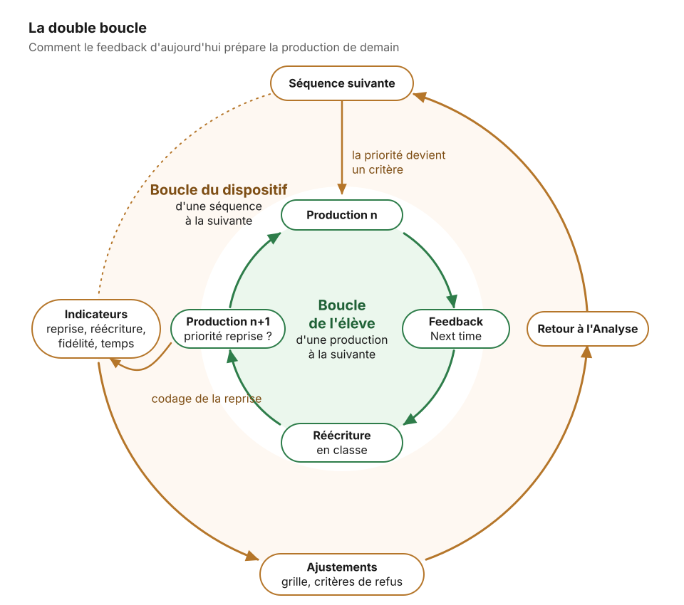

# 05. Évaluation

[← Implémentation](04-implementation.md) · [Sommaire](README.md) · [Retour à l'Analyse ↺](01-analyse.md)

**Question de la phase : le dispositif a-t-il servi aux élèves, et que faut-il changer pour la prochaine fois ?**

Dans ADDIE, l'évaluation porte sur le **dispositif**, pas seulement sur les élèves. Les copies ont été évaluées en phase d'implémentation ; ici, on se demande si ce travail a produit des apprentissages.

## Dans le cas

Le cas s'arrête à l'envoi et à la lecture du feedback individuel. Il ne comportait pas d'Error Hunt et ne mesurait pas ce que le feedback a produit. La boucle de classe proposée ci-dessous est donc une piste pour prolonger le dispositif, pas une description du cas.

## Recommandations

Deux boucles s'emboîtent : celle de l'élève, d'une production à la suivante, et celle du dispositif, d'une séquence à la suivante.

### 1. Boucler en classe

Un temps de cours, à placer dans la semaine qui suit l'envoi :

1. chaque élève lit son fichier et réécrit le passage le plus faible (en corrigeant lui-même ce qui était seulement signalé) ;
2. la classe corrige un Error Hunt de dix phrases construit sur ses propres erreurs, les plus fréquentes d'abord. Les enseignant·es de langues qui le pratiquent sur les erreurs récurrentes de leur classe le jugent très efficace ;
3. deux ou trois extraits réussis, anonymisés, sont lus, chacun illustrant un critère de la grille.

### 2. Mesurer quelques indicateurs simples

| Indicateur | Comment le mesurer | Ce qu'il dit |
|---|---|---|
| **Reprise des priorités** | Pour chaque élève, la priorité Next time est-elle absente, présente ou corrigée dans la production suivante ? | Le feedback a-t-il servi ? |
| **Réécriture effective** | Proportion d'élèves qui ont réellement réécrit le passage faible | Le feedback a-t-il été lu ? |
| **Fidélité des notes** | Un échantillon de copies noté par l'IA et par un·e collègue ; écarts par critère | Sur quels critères l'IA dérive-t-elle ? |
| **Temps enseignant** | Minutes par copie, avant et après | Le gain de temps est-il réel ? |
| **Réception par les élèves** | Quelques questions courtes : avez-vous lu ? compris ? utilisé ? | Le feedback est-il crédible à leurs yeux ? |

Le premier indicateur est le plus important. Codé à la main, il serait beaucoup trop long à relever pour toute une classe : on le fait préparer par l'IA (gabarit « Coder la reprise des priorités » dans [gabarits/prompts.md](gabarits/prompts.md)), on vérifie quelques élèves, puis on reporte le résultat dans le [tableau de suivi des priorités](gabarits/suivi-priorites.md).

### 3. Revenir à l'analyse

Les résultats nourrissent la séquence suivante :

- les priorités Next time non reprises deviennent des critères ou des exercices de la production suivante ;
- les critères sur lesquels les notes dérivent sont réécrits ;
- les critères de refus de la phase Développement sont complétés.

C'est ce retour qui transforme ADDIE en cycle.

## Pour aller plus loin : un protocole de recherche-développement

Le cas se prête à une recherche-développement (design-based research) menée avec des enseignant·es :

- **Effet sur l'apprentissage** : comparer, à grille et tâches égales, un groupe recevant le feedback personnalisé et un groupe recevant seulement la correction collective, à partir du codage de la reprise des priorités.
- **Réception du feedback** : les élèves accordent-ils la même crédibilité à un feedback préparé avec une IA et validé par l'enseignant·e ? Le lisent-ils davantage parce qu'il est individuel, ou moins parce qu'ils le jugent automatique ?
- **Fidélité des notes** : double correction d'un échantillon pour estimer l'accord inter-juges, critère par critère.
- **Transformation du travail enseignant** : que devient le temps gagné ? Lecture plus fine des copies, boucle de classe mieux préparée, ou simple compression ?

## Outils

- [gabarits/suivi-priorites.md](gabarits/suivi-priorites.md)
- Dans [gabarits/prompts.md](gabarits/prompts.md) : « Boucle de classe »

## Checklist de sortie

- [ ] Le temps de classe consacré au feedback a eu lieu.
- [ ] La reprise des priorités est codée pour chaque élève à la production suivante.
- [ ] Au moins un autre indicateur est mesuré.
- [ ] Les ajustements pour la séquence suivante sont notés (grille, critères de refus, priorités de classe).
