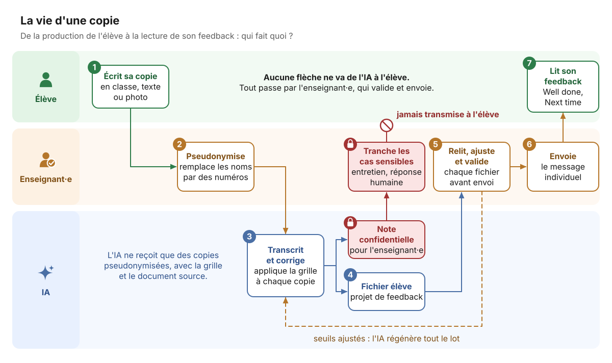
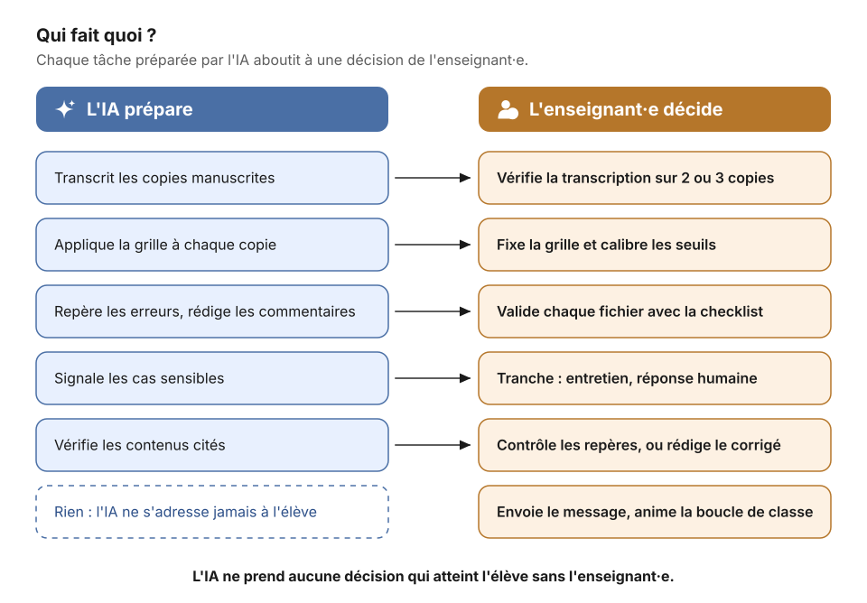

# Remédiation personnalisée assistée par IA : une relecture ADDIE

> Comment personnaliser la remédiation pour chaque élève alors que le temps de correction rend la personnalisation impraticable ?



*La vie d'une copie : l'élève produit, l'IA prépare, l'enseignant·e relit, ajuste, valide et envoie. Aucune flèche ne va de l'IA à l'élève sans passer par l'enseignant·e.*

Ce dépôt propose une **relecture ADDIE d'un retour d'expérience réel** : une séquence d'anglais en Terminale, conçue et corrigée par un·e enseignant·e avec l'aide d'une IA générative, jusqu'à un feedback individuel pour chaque élève de la classe.

L'objectif n'est pas de raconter un usage de l'IA, mais d'en tirer une démarche **réutilisable**, en langues vivantes comme dans toute discipline où les élèves produisent un écrit évalué sur critères.

## Ce que ce dépôt est, et ce qu'il n'est pas

**C'est** une explicitation. L'enseignant·e est formé·e à ADDIE et connaît le modèle. Sa pratique est experte, mais elle n'est pas décrite comme une mise en œuvre d'ADDIE : sous contrainte de temps, avec un outil d'IA, elle ou il a itéré vite, sans nommer les phases. La relecture rend visible cette démarche implicite : elle nomme ce qui a fonctionné, repère ce qui peut être consolidé et en tire des recommandations transmissibles à d'autres collègues.

**Ce n'est pas** une preuve d'efficacité. Il s'agit d'une étude de cas unique. Les effets sur les apprentissages restent à mesurer ; la phase [Évaluation](05-evaluation.md) propose des indicateurs pour le faire.

## Pourquoi ADDIE

ADDIE (Analyse, Design, Développement, Implémentation, Évaluation) est le modèle le plus répandu en ingénierie pédagogique. On lui reproche à juste titre d'être linéaire et lourd. Une pratique experte en fait une version **itérative** : on revient en arrière quand un support est trop complexe, ou quand des notes paraissent mal calibrées.


*En orange, les phases où la décision appartient entièrement à l'enseignant·e ; en bleu, celles où l'IA produit et où l'enseignant·e filtre et valide. Les flèches en pointillé sont les itérations observées dans le cas.*

Mettre la démarche en mots avec ADDIE fait surtout apparaître une distinction que le fil de travail, centré sur l'action, ne rendait pas visible : celle entre **évaluer les apprentissages** (corriger les copies, donner un feedback) et **évaluer le dispositif** (vérifier que ce feedback a servi). La première relève de l'implémentation, la seconde de l'évaluation.

## Le cas relu phase par phase

| Phase | Ce que montre le cas | Ce que ce dépôt ajoute |
|---|---|---|
| [Analyse](01-analyse.md) | Programme, contraintes horaires, travail à distance, risque d'usage de l'IA par les élèves | Un diagnostic explicite des besoins ; le cadre de protection des données posé dès le départ |
| [Design](02-design.md) | Une problématique, une sous-question par semaine, une grille annoncée, des notes bonus pour le travail à distance | Une grille avec descripteurs de niveau ; un type de correction choisi selon l'objectif ; le repérage des erreurs récurrentes |
| [Développement](03-developpement.md) | Supports produits avec l'IA, simplifiés à la demande, vérification des contenus | Des critères de refus explicites ; la vérification des sources comme règle |
| [Implémentation](04-implementation.md) | Production en classe, collecte, feedback individuel envoyé à chaque élève | Une checklist de validation de chaque fichier avant envoi |
| [Évaluation](05-evaluation.md) | Un feedback individuel lu par chaque élève, sans mesure de son effet | Une boucle de classe (Error Hunt) et des indicateurs pour évaluer le dispositif lui-même |

Le cas complet, anonymisé, est dans [00-retour-experience.md](00-retour-experience.md).

## Organisation du dépôt

```
remediation-ia-addie/
├── README.md
├── 00-retour-experience.md     le cas, anonymisé
├── 01-analyse.md
├── 02-design.md
├── 03-developpement.md
├── 04-implementation.md
├── 05-evaluation.md
├── gabarits/
│   ├── prompts.md               consignes à donner à l'IA, phase par phase
│   ├── grille-criteriee.md      construire une grille, avec un exemple
│   ├── modele-feedback.md       format du fichier individuel
│   ├── checklist-validation.md  relecture avant envoi
│   └── suivi-priorites.md       suivi des priorités de chaque élève
├── schemas/                     schémas SVG (sources dans schemas/src/)
├── references.md
├── LICENSE
└── src/, scripts/, astro.config.mjs   le site web (voir ci-dessous)
```

Chaque fichier de phase suit le même plan : **dans le cas** (ce qui s'est passé), **recommandations** (ce qu'on propose de faire), **outils** (les gabarits à utiliser), **points de vigilance**, et une **checklist de sortie** pour passer à la phase suivante.

## Le site

Le guide est aussi publié sous forme de site, avec une roue ADDIE interactive et les schémas : https://jedi-openlab.github.io/remediation-ia-addie/

Les fichiers Markdown de ce dépôt restent la seule source. Le site les reprend à chaque construction (`scripts/sync-content.mjs`) et les schémas SVG sont générés à partir de `schemas/src/`. Pour le lancer en local (Node.js 22.12 ou plus) :

```bash
npm install
npm run dev
```

## Trois façons d'utiliser ce dépôt

1. **Comprendre la démarche** : lire le cas, puis le tableau ci-dessus.
2. **L'appliquer à sa propre séquence** : suivre les cinq phases dans l'ordre et utiliser les [gabarits](gabarits/). Compter une séquence complète pour une première mise en œuvre.
3. **L'étudier** : la phase [Évaluation](05-evaluation.md) propose un protocole léger de recherche-développement (design-based research).

## Prérequis

- Un outil d'IA capable de lire des documents et des images et de produire des fichiers, **validé par l'établissement** pour traiter des productions d'élèves (voir [Analyse](01-analyse.md)).
- Une tâche de production écrite évaluée sur critères.
- Un·e enseignant·e qui reste décisionnaire à chaque phase. L'IA prépare ; l'enseignant·e décide, valide et envoie.



## Anonymisation

L'enseignant·e, la classe et l'établissement ne sont pas identifiés. Aucun extrait de copie réelle n'est reproduit : les exemples sont reconstruits. Les consignes pour l'IA et le modèle de feedback sont généralisés à partir de ceux qui ont fonctionné dans le cas. La grille avec descripteurs, la checklist de validation, le suivi des priorités et les consignes « Repérer les erreurs récurrentes », « Boucle de classe » et « Coder la reprise des priorités » sont des propositions de ce guide.

## Licence et citation

Contenus sous licence [Creative Commons Attribution 4.0 International (CC BY 4.0)](https://creativecommons.org/licenses/by/4.0/deed.fr).

Pour citer :
JEDI-OpenLab (2026). *Remédiation personnalisée assistée par IA : une relecture ADDIE*. D'après le retour d'expérience d'un·e enseignant·e d'anglais en lycée. https://github.com/JEDI-OpenLab/remediation-ia-addie

Ce dépôt fait partie des guides ouverts de [JEDI-OpenLab](https://github.com/JEDI-OpenLab). Le billet associé est publié sur le carnet [JEDI-OpenLab](https://jediopenlab.hypotheses.org/).
