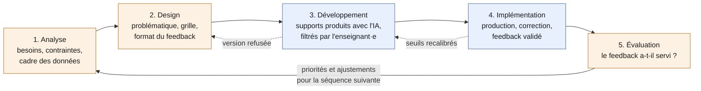

# Remédiation personnalisée assistée par IA : une relecture ADDIE

> Comment personnaliser la remédiation pour chaque élève alors que le temps de correction rend la personnalisation impraticable ?

Ce dépôt propose une **relecture ADDIE d'un retour d'expérience réel** : une séquence d'anglais en Terminale, conçue et corrigée par un·e enseignant·e avec l'aide d'une IA générative, jusqu'à un feedback individuel pour chaque élève de la classe.

L'objectif n'est pas de raconter un usage de l'IA, mais d'en tirer une démarche **réutilisable**, en langues vivantes comme dans toute discipline où les élèves produisent un écrit évalué sur critères.

## Ce que ce dépôt est, et ce qu'il n'est pas

**C'est** une grille de lecture. L'enseignant·e n'a pas suivi ADDIE : elle ou il a itéré vite, sous contrainte de temps, avec un outil d'IA. Le modèle ADDIE sert ici à relire après coup ce qui a été fait, à nommer ce qui a fonctionné, à repérer ce qui manquait et à en faire des recommandations.

**Ce n'est pas** une preuve d'efficacité. Il s'agit d'une étude de cas unique. Les effets sur les apprentissages restent à mesurer ; la phase [Évaluation](05-evaluation.md) propose des indicateurs pour le faire.

## Pourquoi ADDIE

ADDIE (Analyse, Design, Développement, Implémentation, Évaluation) est le modèle le plus répandu en ingénierie pédagogique. On lui reproche à juste titre d'être linéaire et lourd. Le cas étudié montre justement une version **itérative** du modèle : trois versions d'une même séance produites en une heure, deux écartées, une adoptée. L'évaluation formative traverse toutes les phases au lieu d'attendre la fin.



*En orange, les phases où la décision appartient entièrement à l'enseignant·e ; en bleu, celles où l'IA produit et où l'enseignant·e filtre et valide. Les flèches en pointillé sont les itérations observées dans le cas.*

ADDIE apporte surtout une distinction que le retour d'expérience brut ne faisait pas : celle entre **évaluer les apprentissages** (corriger les copies, donner un feedback) et **évaluer le dispositif** (vérifier que ce feedback a servi). La première relève de l'implémentation, la seconde de l'évaluation.

## Le cas relu phase par phase

| Phase | Ce que montre le cas | Ce que ce dépôt ajoute |
|---|---|---|
| [Analyse](01-analyse.md) | Programme, contraintes horaires, travail à distance, risque d'usage de l'IA par les élèves | Un diagnostic explicite des besoins ; le cadre de protection des données posé dès le départ |
| [Design](02-design.md) | Une problématique, une sous-question par semaine, une grille annoncée, des notes bonus | Une grille avec descripteurs de niveau ; un feedback modulé selon les élèves |
| [Développement](03-developpement.md) | Supports produits avec l'IA, versions refusées, vérification des contenus | Des critères de refus explicites ; la vérification des sources comme règle |
| [Implémentation](04-implementation.md) | Production en classe, collecte, feedback individuel envoyé à chaque élève | Une checklist de validation de chaque fichier avant envoi |
| [Évaluation](05-evaluation.md) | Boucle de classe (Error Hunt, priorités reprises) | Des indicateurs pour évaluer le dispositif lui-même |

Le cas complet, anonymisé, est dans [00-retour-experience.md](00-retour-experience.md).

## Organisation du dépôt

```
remediation-ia-addie/
├── README.md
├── 00-retour-experience.md     le cas, anonymisé
├── 01-analyse.md
├── 02-design.md
├── 03-developpement.md
├── 04-implementation.md
├── 05-evaluation.md
├── gabarits/
│   ├── prompts.md               consignes à donner à l'IA, phase par phase
│   ├── grille-criteriee.md      modèle de grille avec descripteurs
│   ├── modele-feedback.md       format du fichier individuel
│   ├── checklist-validation.md  relecture avant envoi
│   └── suivi-priorites.md       suivi des priorités de chaque élève
├── references.md
└── LICENSE
```

Chaque fichier de phase suit le même plan : **dans le cas** (ce qui s'est passé), **recommandations** (ce qu'on propose de faire), **outils** (les gabarits à utiliser), **points de vigilance**, et une **checklist de sortie** pour passer à la phase suivante.

## Trois façons d'utiliser ce dépôt

1. **Comprendre la démarche** : lire le cas, puis le tableau ci-dessus.
2. **L'appliquer à sa propre séquence** : suivre les cinq phases dans l'ordre et utiliser les [gabarits](gabarits/). Compter une séquence complète pour une première mise en œuvre.
3. **L'étudier** : la phase [Évaluation](05-evaluation.md) propose un protocole léger de recherche-développement (design-based research).

## Prérequis

- Un outil d'IA capable de lire des documents et des images et de produire des fichiers, **validé par l'établissement** pour traiter des productions d'élèves (voir [Analyse](01-analyse.md)).
- Une tâche de production écrite évaluée sur critères.
- Un·e enseignant·e qui reste décisionnaire à chaque phase. L'IA prépare ; l'enseignant·e décide, valide et envoie.

## Anonymisation

L'enseignant·e, la classe et l'établissement ne sont pas identifiés. Aucun extrait de copie réelle n'est reproduit : les exemples sont reconstruits. Les gabarits ont été généralisés à partir des consignes qui ont fonctionné dans le cas.

## Licence et citation

Contenus sous licence [Creative Commons Attribution 4.0 International (CC BY 4.0)](https://creativecommons.org/licenses/by/4.0/deed.fr).

Pour citer :
JEDI-OpenLab (2026). *Remédiation personnalisée assistée par IA : une relecture ADDIE*. D'après le retour d'expérience d'un·e enseignant·e d'anglais en lycée. https://github.com/JEDI-OpenLab/remediation-ia-addie

Ce dépôt fait partie des guides ouverts de [JEDI-OpenLab](https://github.com/JEDI-OpenLab). Le billet associé est publié sur le carnet [JEDI-OpenLab](https://jediopenlab.hypotheses.org/).
