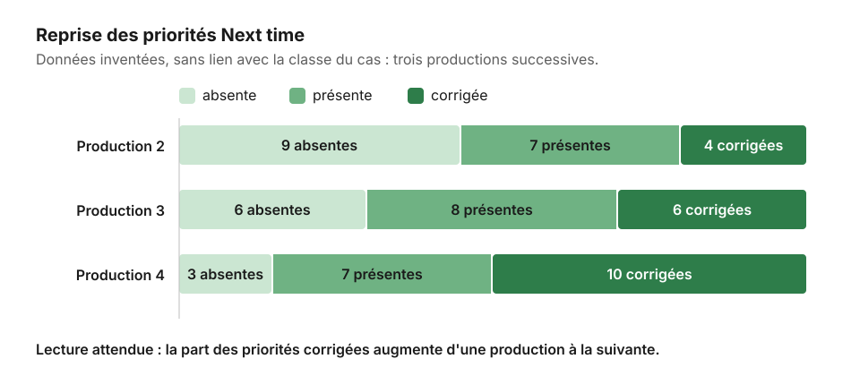

# Tableau de suivi des priorités

[← Sommaire](../README.md) · [Phase Évaluation](../05-evaluation.md)

Ce tableau est tenu par l'enseignant·e, dans un fichier personnel ou un tableur de l'établissement. Il remplace l'historique que l'on serait tenté de confier à l'outil d'IA : les données restent chez l'enseignant·e, et le suivi ne dépend pas d'un outil.

Le codage de la reprise (absente, présente, corrigée) serait trop long à faire à la main pour toute une classe. On le fait préparer par l'IA avec le gabarit « Coder la reprise des priorités » ([gabarits/prompts.md](prompts.md)), on vérifie quelques élèves, puis on reporte le résultat dans ce tableau.

## Modèle

| Élève | Production 1 : priorité Next time | Production 2 : reprise | Production 2 : nouvelle priorité | Production 3 : reprise |
|---|---|---|---|---|
| 01 | Prétérit après *if* | corrigée | Connecteurs d'opposition | |
| 02 | Citer un détail exact du document | présente | Citer un détail exact du document | |
| 03 | Accord sujet-verbe au présent | absente | Accord sujet-verbe au présent | |
| ... | | | | |

**Codage de la reprise**

- **absente** : le problème n'est pas traité dans la production suivante ;
- **présente** : l'élève essaie, avec des erreurs ;
- **corrigée** : le problème est résolu.

*Données inventées pour illustrer la lecture du tableau : elles n'ont aucun lien avec la classe.*

## Ce qu'on en fait

- Une priorité **corrigée** devient une réussite à nommer dans la ligne Well done suivante.
- Une priorité **absente** deux fois de suite appelle un échange avec l'élève : la consigne est-elle comprise ?
- Les trois priorités les plus fréquentes de la classe deviennent des critères ou des exercices de la production suivante.
- La proportion de priorités corrigées est le premier indicateur d'efficacité du dispositif (voir [Évaluation](../05-evaluation.md)).
